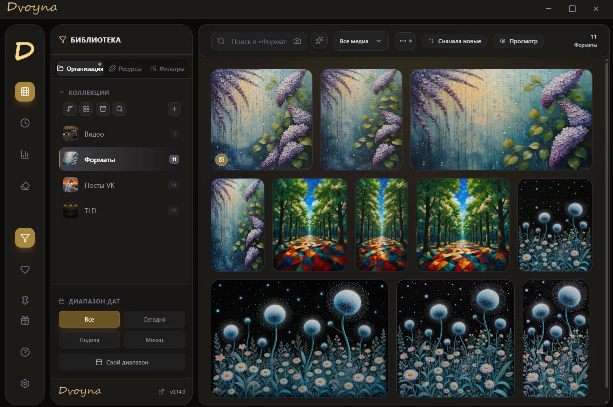

<div align="center">


# Dvoyna Vault
### Локальная библиотека изображений и видео, созданных ИИ
</div>

**Dvoyna Vault** (коротко **Dvoyna** или **DV**) ведёт локальную библиотеку изображений и видео, созданных ИИ. Исходные файлы остаются в своих папках. Каталог, миниатюры, поиск и настройки хранятся на вашем компьютере, без телеметрии.

Основано на Ambit by AsuraAce — https://github.com/AsuraAce/ambit

Каталог Dvoyna хранится отдельно (`com.dvoyna.vault`) и оставляет уже существующую библиотеку Ambit на месте.

<p align="center">
  
</p>

<!-- Здесь позже добавим ещё скриншоты. -->

## Возможности

*   **Русский интерфейс.** Язык переключается в настройках. Если язык системы русский, первый запуск открывается по-русски.
*   **Коллекции.** Ручные подборки и умные коллекции по правилам. Если открыта ручная коллекция, разовый импорт (выбранные изображения, видео или папка) добавляет файлы в библиотеку и в эту коллекцию. В окне импорта есть флажок «Добавить в коллекцию: <имя>». Для открытой ручной коллекции он включён по умолчанию. В общей библиотеке и в умной коллекции флажка нет. Файл, который уже есть в библиотеке, попадает в коллекцию без второй копии. Счётчик и сетка обновляются сразу после импорта.
*   **Фильтры** по генератору, модели, сэмплеру, цвету и дате.
*   **Поиск по синтаксису.** В строке поиска работают операторы `model:` и `tool:`, например `model:sdxl tool:comfy`, вместе с обычными словами промпта.
*   **Поиск по фото** со значка камеры в строке поиска.
*   **Просмотр видео:** постеры, воспроизведение и переход по текущей подборке. Воспроизведение опирается на медиавозможности Windows.
*   **Избранное и закреплённые** снимки.
*   **Метаданные:** чтение промпта, воркфлоу и ресурсов из файла и ручные правки.
*   **Интеграции** InvokeAI, ComfyUI и SD WebUI.
*   **Ассистент Gemini** по желанию и только со своим ключом.
*   **Поиск хеша модели на CivitAI** после подтверждения «Определить онлайн». Уходит хеш, не файл изображения.

## Установка в Windows

Готовые сборки сейчас выходят для Windows.

1. Скачайте установщик. Имя файла заканчивается на `-setup.exe`.
   * Сборка [windows-installer](https://github.com/x0mirag0x/ambit/actions/workflows/windows-installer.yml): откройте нужный запуск и скачайте артефакт `Dvoyna-Vault-windows-setup`. Артефакт хранится около 14 дней.
   * Либо страница [Releases](https://github.com/x0mirag0x/ambit/releases), если установщик уже опубликован там.
2. Запустите установщик и откройте Dvoyna Vault.
3. **SmartScreen.** Установщик не подписан. Windows может предупредить о неизвестном издателе («Система Windows защитила ваш компьютер»). Нажмите «Подробнее», затем «Выполнить в любом случае». В английской Windows: More info, затем Run anyway.

Для установки не нужны Node.js, pnpm, Rust и редактор кода.

Пошаговое руководство: [docs/manual/index.md](docs/manual/index.md) (пока на английском).

Ошибки и пожелания: [GitHub Issues](https://github.com/x0mirag0x/ambit/issues).

## Сборка из исходников

Нужны Node.js 24 или новее, pnpm 11.5.3 и Rust 1.96.0 (версия зафиксирована в `rust-toolchain.toml`).

```bash
git clone https://github.com/x0mirag0x/ambit.git
cd ambit
pnpm install
pnpm run app:dev
```

Проверки и правила для сопровождающих: [CONTRIBUTING.md](CONTRIBUTING.md).

Сейчас проект ведёт сопровождающий. Сообщения об ошибках, правки документации и идеи принимаются. Пул-реквесты с кодом на время публичной беты не принимаются.

Сообщения по безопасности отправляйте по [SECURITY.md](SECURITY.md), не через обычный issue.

## Конфиденциальность

Библиотека, поиск, разбор метаданных, миниатюры и настройки работают локально. Телеметрии нет.

Сеть нужна только в этих случаях:

*   Проверка обновлений выключена по умолчанию. После включения приложение обращается к GitHub Releases этого репозитория. Скачивание и установка идут после вашего подтверждения. Неподписанный установщик из Actions нельзя поставить как автоматическое обновление.
*   Gemini необязателен. Запрос уходит, когда вы сами проверяете ключ или запускаете действие ассистента.
*   Разрешение хеша на CivitAI необязательно. Оно стартует после «Определить онлайн» и отправляет строки хешей неразрешённых моделей, не файлы изображений.
*   Внешние ссылки, включая поддержку, открываются только по нажатию.

## Поддержка

Dvoyna Vault бесплатный, отдельных платных функций нет.

Поддержать проект: https://vk.ru/dvoyna_studio

## Лицензия

Dvoyna Vault распространяется по GNU General Public License v3.0 only (GPL-3.0). Текст лицензии: [LICENSE](LICENSE).

Основано на Ambit by AsuraAce — https://github.com/AsuraAce/ambit
